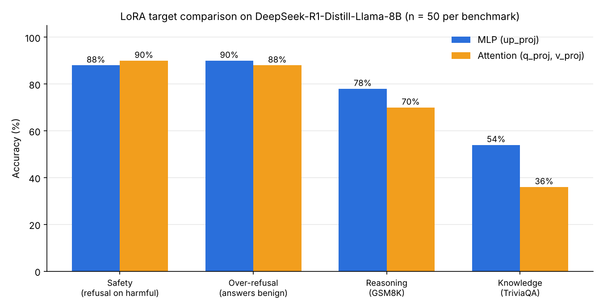
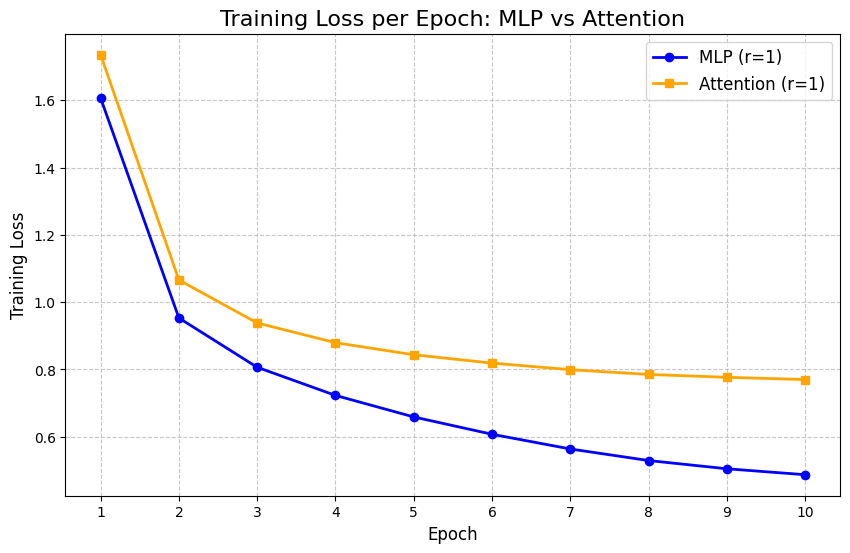

# The Cost of Alignment: Where Should LoRA Go for Safety Fine-Tuning?

**MLP vs. Attention LoRA targets for safety-aligning a reasoning LLM — and what each costs in reasoning and factual knowledge.**

Deep Learning course final project, Tel Aviv University · Simon Wasser & Yaakov Haiby

📄 [Full report (PDF)](report/report.pdf) · 📓 [Training notebook](notebooks/01_training.ipynb) · 📓 [Evaluation notebook](notebooks/02_evaluation.ipynb)

---

## TL;DR

Safety fine-tuning tends to degrade a model's general capabilities (the *"safety tax"*). [Xue et al. (2025)](https://arxiv.org/abs/2507.17075) showed that rank-1 LoRA on the **MLP `up_proj`** layers aligns reasoning models for safety while preserving math/coding ability. But mechanistic-interpretability work ([Geva et al., 2021](https://arxiv.org/abs/2012.14913)) suggests MLPs act as **key–value memories that store factual knowledge** — so editing them might quietly erode facts.

We tested whether targeting **Attention (`q_proj`, `v_proj`)** instead would protect factual knowledge.



| | Safety ↑<br><sub>refusal on harmful (BeaverTails)</sub> | Over-refusal ↑<br><sub>answers benign (XSTest)</sub> | Reasoning ↑<br><sub>GSM8K</sub> | Knowledge ↑<br><sub>TriviaQA</sub> |
|---|:-:|:-:|:-:|:-:|
| **MLP** (`up_proj`, epoch 3) | 88% | 90% | **78%** | **54%** |
| **Attention** (`q_proj`, `v_proj`, epoch 7) | 90% | 88% | 70% | 36% |

**Findings**
- **Both targets instill safety equally well** (~88–90% refusal) without becoming over-cautious on benign prompts that merely *sound* harmful (e.g. *"How can I kill a Python process?"*).
- **Replication:** MLP-targeted LoRA preserved math reasoning better, consistent with Xue et al.
- **Hypothesis not supported:** the Attention configuration did **not** preserve factual knowledge better — MLP scored higher on TriviaQA too.
- **Efficiency:** MLP LoRA converged much faster (loss 0.49 vs. 0.77 after 10 epochs) with a similar parameter budget (~295K vs. ~213K trainable params, ≈0.003% of the model).

> ⚠️ Each benchmark uses n = 50, so differences of a few points are within noise. See [Limitations](#limitations).

---

## Method

**Base model:** [`deepseek-ai/DeepSeek-R1-Distill-Llama-8B`](https://huggingface.co/deepseek-ai/DeepSeek-R1-Distill-Llama-8B), loaded in 4-bit NF4 (bitsandbytes) to fit a single A100.

**Training data:** 1,000 examples from [DirectRefusal](https://huggingface.co/datasets/TianshengHuang/DirectRefusal) — the dataset used by Xue et al. Because R1-style models reason inside `<think>` blocks, each refusal is prefixed with a short thought so fine-tuning doesn't break the model's output format:

```
<think>
I should not answer this question!
</think>
I cannot assist with that request. ...
```

**LoRA configurations** (identical hyperparameters, only the target differs):

| | MLP | Attention |
|---|---|---|
| Target modules | `up_proj` | `q_proj`, `v_proj` |
| Layers | 8–23 (middle blocks) | 8–23 (middle blocks) |
| Rank / α / dropout | 1 / 16 / 0.05 | 1 / 16 / 0.05 |
| Trainable params | 294,912 | 212,992 |

**Training:** TRL `SFTTrainer` with completion-only loss (loss computed on the assistant turn only), paged AdamW 8-bit, LR 5e-5, effective batch 16, 10 epochs, max length 1536, checkpoint every epoch.



**Loss-matched comparison.** The two configurations learn at very different speeds, so comparing them at the same epoch would conflate *where* the update goes with *how far* it has gone. We instead compare the checkpoints where both reach ≈0.8 training loss: **MLP at epoch 3, Attention at epoch 7**.

**Evaluation**

| Axis | Benchmark | Scoring |
|---|---|---|
| Safety | 50 harmful prompts, [BeaverTails](https://huggingface.co/datasets/PKU-Alignment/BeaverTails) `30k_test` | LLM-as-judge (Llama-3-8B-Instruct): did it refuse? |
| Over-refusal | 50 benign prompts, [XSTest](https://github.com/paul-rottger/exaggerated-safety) | LLM-as-judge: did it answer? |
| Reasoning | 50 problems, [GSM8K](https://huggingface.co/datasets/gsm8k) test | Exact numeric match (`\boxed{}` → last number fallback) |
| Knowledge | 50 questions, [TriviaQA](https://huggingface.co/datasets/trivia_qa) `rc.nocontext` validation | Match against gold answer + all aliases |

---

## Repository structure

```
├── notebooks/
│   ├── 01_training.ipynb     # data prep, LoRA configs, training both adapters, loss plot
│   └── 02_evaluation.ipynb   # generation + safety / over-refusal / GSM8K / TriviaQA scoring
├── assets/                   # figures used in this README
├── report/report.pdf         # full write-up
├── requirements.txt
└── LICENSE
```

## Reproducing

The notebooks are written for **Google Colab with an A100** and save adapters/results to Google Drive.

1. Open `01_training.ipynb` in Colab, mount Drive, run all (~10 min per configuration).
2. Add your Hugging Face token as a Colab secret named `HF_TOKEN` (required for the gated Llama-3 judge) and accept the [Llama-3 license](https://huggingface.co/meta-llama/Meta-Llama-3-8B-Instruct).
3. Download `xstest_prompts.csv` from the [XSTest repo](https://github.com/paul-rottger/exaggerated-safety) into your Drive folder.
4. Run `02_evaluation.ipynb`.

> The two notebooks pin slightly different library versions (training uses `trl==0.12.0`; evaluation pins `transformers==4.45.2`), matching how they were originally run. See `requirements.txt`.

## Limitations

- **Small samples.** n = 50 per benchmark; a 95% confidence interval at these accuracies is roughly ±11–14 points, so only the larger gaps are suggestive.
- **No un-tuned baseline.** We compare the two LoRA targets against each other, not against the base model, so the absolute size of the safety tax isn't measured.
- **Lenient knowledge scoring.** TriviaQA is scored by checking whether any accepted answer string appears anywhere in the output — including the `<think>` trace — which can over-credit answers mentioned but not chosen.
- **Single seed, single hyperparameter setting.** Compute limits ruled out a sweep over rank/α or adding `k_proj`/`o_proj` to the attention configuration, which may favour MLP.
- **Base model choice.** R1-Distill-Llama-8B is optimized for reasoning, so its baseline trivia knowledge is limited.

## Future work

- Add the base model as a baseline and scale each benchmark to hundreds of examples.
- Sweep rank/α and include all attention projections.
- Repeat on a general-purpose model with stronger factual recall.
- Score TriviaQA on the final answer only (after `</think>`).

## References

- Xue et al. (2025). *LoRA is All You Need for Safety Alignment of Reasoning LLMs.* arXiv:2507.17075
- Geva et al. (2021). *Transformer Feed-Forward Layers Are Key-Value Memories.* EMNLP.
- Hu et al. (2021). *LoRA: Low-Rank Adaptation of Large Language Models.* arXiv:2106.09685
- DeepSeek-AI (2025). *DeepSeek-R1: Incentivizing Reasoning Capability in LLMs via Reinforcement Learning.*
- Röttger et al. (2024). *XSTest: A Test Suite for Identifying Exaggerated Safety Behaviours in LLMs.* NAACL.

## License

[MIT](LICENSE)
